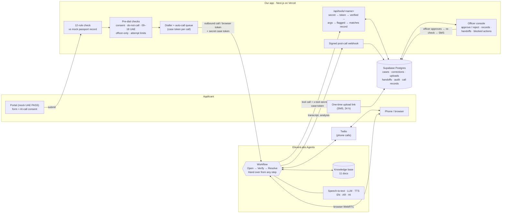

# Architecture (one page)

## How one call flows

1. **Return found.** The applicant submits; the 12-rule check finds a fixable problem. If they opted in, the case is queued for a call.
2. **Pre-dial.** Consent, do-not-call list, UAE calling hours (phone only), officer-only cases and attempt limits are checked *before* dialling. A refusal is logged and the applicant gets an SMS instead.
3. **Dial.** Our server creates a random one-time **case token** (stored only as a SHA-256 hash) and starts the call: a Twilio outbound call for phone, a WebRTC token for browser. The token travels as an ElevenLabs `secret__` variable, so it's sent in a tool header and never shown to the model.
4. **Talk.** The agent's workflow has four steps, and **each step only has its own tools**:

   | Step | Tools it has |
   |---|---|
   | Open: AI disclosure, "is now a good time?" | `create_callback`, `record_opt_out`, `end_call` |
   | Verify: reference + date of birth, no secrets | + `verify_identity` |
   | Resolve: explain every issue, then fix or route | + `get_case`, `submit_correction`, `send_upload_link`, `check_upload`, `list_slots`, `book_appointment`, `create_followup` |
   | Hand over: upset, dispute, asks for a person | `create_callback` (escalate) |

   Built-in `language_detection` switches to Arabic or Hindi when the caller does; `voicemail_detection` hangs up without leaving case details.
5. **Act.** Every tool is one endpoint on our server, which checks in order: tool secret → case token valid for a live call → caller verified on this call → arguments → field really flagged → new value matches the passport record. Failures come back as `ok: false` + a reason the agent can explain; the refusal is written to **Blocked actions**.
6. **Decide.** Nothing the agent does changes the application. Corrections and uploads land as **pending officer review**; the officer approves in the console, the rules re-run, and the applicant gets an SMS and a portal update.
7. **Record.** ElevenLabs' signed post-call webhook (HMAC, 30-min window) stores the transcript, LLM latency, 7 evaluation checks and the collected data in **Call records**.

## Two locks on every high-stakes action

| | Lock 1: the agent | Lock 2: our server |
|---|---|---|
| Before verification | Verify step has no `get_case` or fix tools | Refuses any case tool until `verify_identity` succeeded on this call |
| `submit_correction` | Prompt: read back letter by letter, clear "yes" first | Field must be flagged; value must match the passport record; goes to an officer, never straight into the application |
| Payment, approvals, timelines | Guardrails in the system prompt | No payment or approval tool exists |
| Officer-only cases | — | Pre-dial check blocks the call |

## If something fails

| Failure | What happens |
|---|---|
| Our server down mid-call | Tool returns `temporarily_unavailable`; the agent says it can't finish, books a callback, promises nothing |
| Call drops | Nothing half-saved; corrections are single-shot; the next call resumes from the case |
| No answer / voicemail | No case details left; next-day retry inside calling hours |
| Caller says stop | `record_opt_out`, number added to do-not-call immediately |

## Where data lives

All case data stays in our database; ElevenLabs only sees what the tools return for the verified caller. Phone numbers are masked to the last 4 digits in the console. The database is server-only (RLS on, no public access); uploads are in a private bucket behind one-time links.
